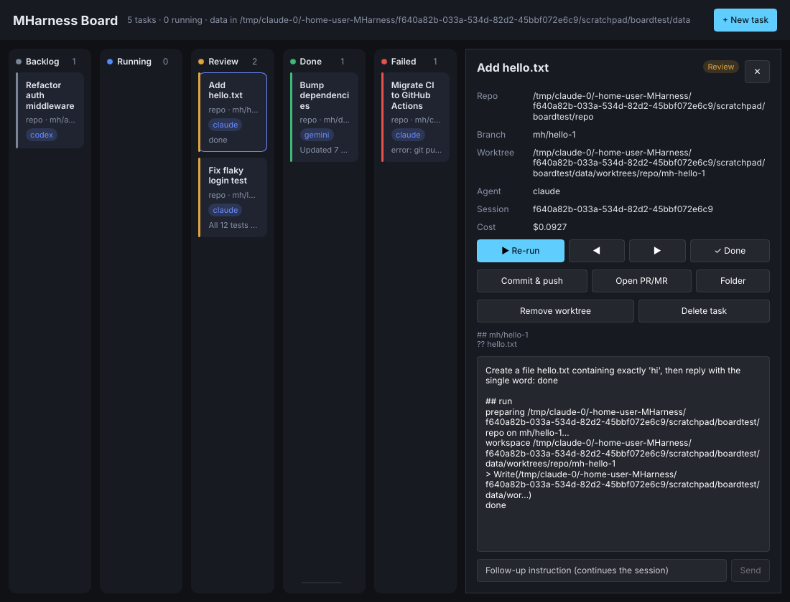

# MHarness

A tiny, fast, cross-platform **agent harness in Rust** that drives the agent CLIs
you are *already logged into*: Claude Code, OpenAI Codex, Gemini CLI, or any
other terminal program. It never asks for an API key and never touches your
credentials. It runs the real CLI as a child process, so whatever auth that CLI
has (Claude Pro/Max subscription, `codex login`, Google login, API key env vars)
is what gets used.

- **One normalized event stream** (`session`, `text`, `tool_use`, `tool_result`, `done`, `error`) across providers
- **Multi-turn sessions**: `chat` resumes the provider's own session between turns
- **Pipe-friendly**: answer on stdout, tool activity on stderr, `--json` NDJSON for programs
- **Lean**: no async runtime, ~1 MB static binary, ~3 MB RSS while streaming
- **macOS, Linux, Windows** (handles npm `.cmd` shims via `PATHEXT`)

## Install

```sh
cargo install --git https://github.com/davialos/MHarness
# or grab a prebuilt binary from Releases (tag v* builds linux-musl, macOS, Windows; x64 + arm64)
```

You also need at least one provider CLI installed and logged in once in a terminal:

| Provider | Install | Log in |
|---|---|---|
| `claude` | `npm i -g @anthropic-ai/claude-code` (or the native installer) | run `claude` once and `/login` |
| `codex` | `npm i -g @openai/codex` | `codex login` |
| `gemini` | `npm i -g @google/gemini-cli` | run `gemini` once |

`mharness providers` shows which are found and their versions.

## Usage

```sh
# One-shot (prompt from args or stdin)
mharness run "explain src/main.rs"
cat task.md | mharness run

# Choose provider / model / directory
mharness run -p codex -m gpt-5 -C ~/proj "add a unit test for parse()"

# Pass flags straight to the provider CLI after `--`
mharness run "fix the failing test" -- --allowedTools "Bash Edit" --max-turns 10

# Machine-readable stream
mharness run --json "list TODOs" | jq -c 'select(.type=="tool_use")'

# Provider's own output untouched
mharness run --raw "hi"

# Interactive chat that keeps the session (/new, /session, /exit)
mharness chat -p claude
mharness chat --resume <session-id>
```

`-v` shows session id, tool results, duration and cost on stderr. Exit code is
`0` on success, `1` if the agent reported an error or the CLI failed, `2` for
harness errors (e.g. the CLI isn't installed).

### Event format (`--json`)

```json
{"type":"session","id":"8f0c..."}
{"type":"tool_use","name":"Bash","input":{"command":"ls"}}
{"type":"tool_result","output":"README.md\nsrc","is_error":false}
{"type":"text","text":"There are two entries."}
{"type":"done","result":"There are two entries.","is_error":false,"cost_usd":0.012,"duration_ms":3558}
```

## Board (desktop app)

`mharness-board` is a Kanban desktop app (Rust + [Slint](https://slint.dev)) for running
many agent tasks in parallel, each on its own branch.



- **Columns**: Backlog → Running → Review → Done, plus Failed. A finished run moves to
  Review, an error or Stop moves to Failed. ◀ ▶ move a card by hand; ✓ marks it Done.
- **Isolation per task**: every task gets a branch (`mh/<title>-<id>` unless you name one).
  With *Isolated git worktree* on, the agent works in its own `git worktree`, so several tasks
  on the same repo run at once without touching your checkout. Off means it switches the
  repo's own checkout to that branch. Two running tasks can never share a directory.
- **Local or remote repos**: a local path, any clone URL, or `github:owner/repo` /
  `gitlab:group/repo`. Remotes are cloned once into the data dir and fetched before each run,
  using your own git credentials (SSH keys, credential helper).
- **Live log** of text, tool calls and errors; session id and cost; `git status` of the worktree.
- **Follow-up**: send another instruction that continues the same agent session.
- **Commit & push** (commits anything uncommitted with the task title), **Open PR/MR** through
  your logged-in `gh` (GitHub) or `glab` (GitLab), **Folder**, **Remove worktree** (branch kept).
- Tasks persist in `board.json` in the data dir (`~/.local/share/mharness`,
  `~/Library/Application Support/mharness`, `%LOCALAPPDATA%\mharness`, or `$MHARNESS_DATA`).
  Worktrees live under `<data>/worktrees/<repo>/<branch>`.

```sh
cargo install --git https://github.com/davialos/MHarness mharness-board
cd ~/code/my-repo && mharness-board     # the current repo is pre-filled for new tasks
```

The board idles at about 20 MB RSS and stays near 25 MB while agents run (measured on Linux with
the software renderer); each agent CLI it starts uses its own memory on top. Linux builds need
`libfontconfig1-dev` and `libxkbcommon-dev`; running needs X11 or Wayland.

## Configuration

Optional. `mharness config-path` prints where it's read from
(`~/.config/mharness/config.toml`, `%APPDATA%\mharness\config.toml`, or `$MHARNESS_CONFIG`).
See [`config.example.toml`](config.example.toml). Define extra providers with a `kind`
(`claude`, `codex`, `gemini`, `text`), a `program`, and fixed `args`. `text` works
with any CLI: `{prompt}` in `args` is substituted, otherwise the prompt goes to stdin.
`MHARNESS_PROVIDER` sets the default provider for a shell.

## Library

```rust
use mharness::{Config, Event, Request, runner};

let spec = Config::load()?.resolve(Some("claude"))?;
let req = Request { prompt: "Summarize README.md".into(), ..Default::default() };
let out = runner::run(&spec, &req, None, &mut |e: &Event| {
    if let Event::Text { text } = e { print!("{text}") }
})?;
println!("\nresume later with {:?}", out.session);
```

## How it works

```
mharness ──spawn──▶ claude -p --output-format stream-json --resume <id>   (prompt on stdin)
   ▲                       │
   └── parser ◀─ JSONL ────┘   → normalized Event → human / --json / --raw sink
```

Each turn is one child process: a stdin-writer thread plus a buffered line
reader on the main thread. Prompts go over stdin (Claude, Codex) to avoid argv
limits and Windows `cmd.exe` quoting issues. Session continuity uses each CLI's
own resume flag, so history lives where the CLI keeps it.

Provider status: **Claude** is verified against Claude Code 2.1.x stream-json.
**Codex** (`codex exec --json`) and **Gemini** (`--output-format stream-json`)
follow their documented event formats and are covered by fixture tests.

## Development

```sh
cargo test --workspace
cargo clippy --workspace --all-targets -- -D warnings
cargo build --release            # CLI only: target/release/mharness
cargo build --release --workspace   # CLI + board
```

CI runs fmt, clippy and tests on Ubuntu, macOS and Windows. Pushing a `v*` tag
publishes release binaries.

## License

MIT. The board's UI uses [Slint](https://slint.dev) under the Slint Royalty-free Desktop,
Mobile and Web Applications License, which requires attributing Slint (this notice and the
link above).
